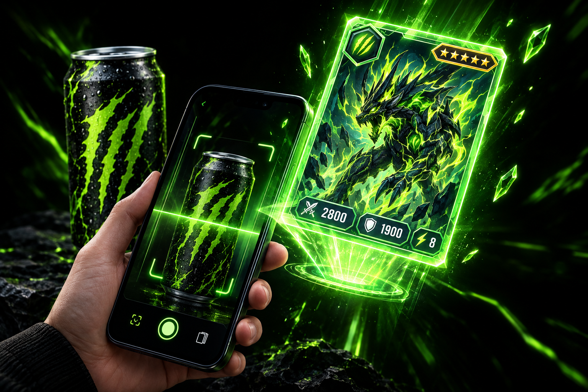

# Monster-Energy-TCG



An Android app (built with Flutter) that scans your Monster Energy can and turns it into a trading card for your virtual collection.

> **Status:** early development. The concept art above is illustrative only, not a screenshot.

## How it works

1. **Scan** – point the camera at the barcode on the can.
2. **Identify** – the barcode is matched to a flavor. The first time you scan an unknown barcode, you pick the flavor and the app remembers it.
3. **Generate** – a card is created procedurally and deterministically from the flavor's data, so the same flavor always gives the same card.
4. **Collect** – the card is saved to your local collection. Scanning the same flavor again adds a duplicate copy.

## Card stats

| Stat | Derived from |
| --- | --- |
| Rarity | Product line (Rehab → Ultra → Original → Juice → Java) |
| Attack / Speed | Caffeine content |
| Defense | Sugar content |
| Energy cost | Calories |
| Ability | Product line, picked deterministically |

## Tech stack

- Flutter (Android target)
- [`mobile_scanner`](https://pub.dev/packages/mobile_scanner) for barcode scanning
- [`sqflite`](https://pub.dev/packages/sqflite) for local storage, no account or backend required

## Roadmap

- [x] Project setup and design decisions
- [ ] Flavor catalog and procedural card generator
- [ ] Barcode scan flow with barcode-to-flavor linking
- [ ] Collection screen with duplicate counts
- [ ] Photo-based can recognition
- [ ] Real card artwork

## Website

The promo site is [index.html](index.html), a single file with no build step. Once GitHub Pages is enabled it is served at **https://nikolmichaelidou.github.io/Monster-Energy-TCG/**.

To publish it:

1. Make sure `index.html` and `docs/banner.png` are committed and pushed to `main`.
2. In the repository go to **Settings → Pages**.
3. Under **Build and deployment**, choose **Deploy from a branch**, then select `main` and `/ (root)`.
4. Save. The first deploy takes a minute or two.

To preview it locally, open `index.html` in a browser.

## Getting started

Requires the [Flutter SDK](https://docs.flutter.dev/get-started/install) and an Android device or emulator.

```bash
flutter create . --platforms=android
flutter pub get
flutter run
```

## Disclaimer

This is an unofficial fan project. It is not affiliated with, endorsed by, or sponsored by Monster Beverage Corporation. Monster Energy and related marks are trademarks of their respective owners.